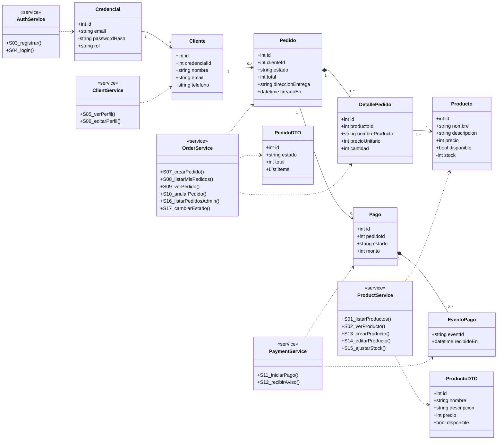
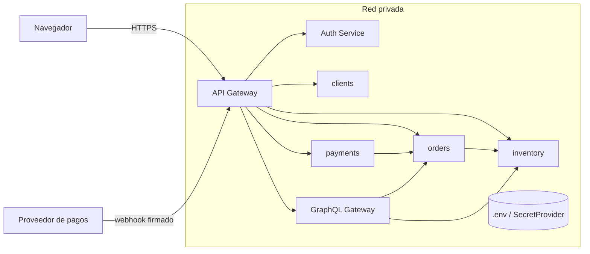
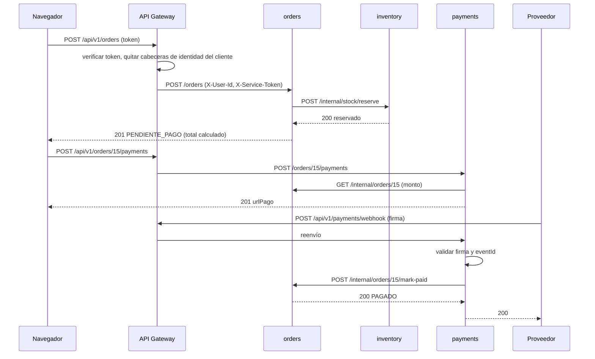
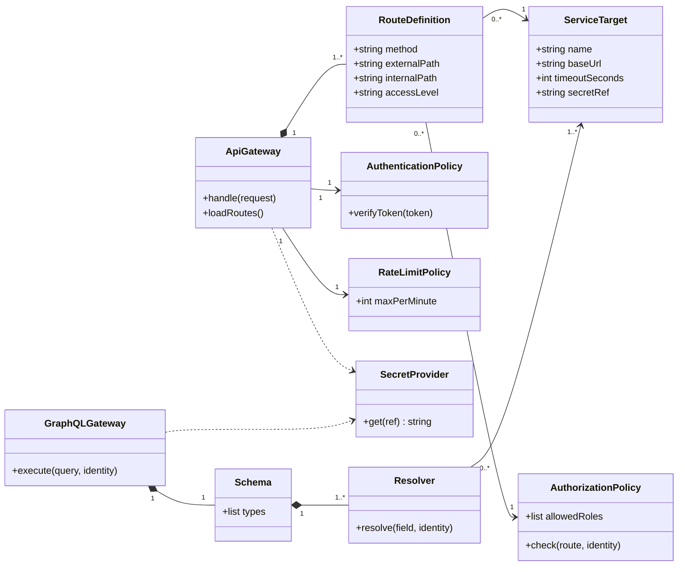

# la Nonna — Backend seguro (Evaluación 2)

Este Readme lo genere con claude para que se viese bonito y profesional.

Backend del sitio de pastas frescas "la Nonna". Esta entrega es solo backend; la integración con el frontend queda para la entrega 3.

- **Caso:** (número y nombre del caso)
- **Integrantes:** (nombres)
- **Versión del frontend:** (commit o tag del repositorio del frontend)
- **Integración con el frontend:** pendiente para la entrega 3. Los contratos usan los mismos campos que muestra el frontend (`id, nombre, descripcion, precio`), así que la integración será reemplazar los datos fijos del HTML por llamadas a la API.

## Cómo ejecutar

> Completar al terminar el Módulo 10: requisitos, instalación, variables de entorno (`.env.example`), comando para iniciar y detener cada servicio, datos de prueba y cómo correr las pruebas.

## Arquitectura (resumen)

| Componente | Rol | Acceso |
|---|---|---|
| API Gateway | Única entrada pública; valida token y reenvía solo rutas permitidas | Público |
| Auth Service | Registro de credenciales, login, emisión de tokens | Privado |
| inventory | Catálogo, disponibilidad, stock | Privado |
| orders | Pedidos y su ciclo de vida | Privado |
| clients | Perfil de clientes | Privado |
| payments | Inicio de pagos y notificaciones del proveedor | Privado |
| GraphQL Gateway | Agregaciones (por ejemplo `resumenPedido`) | Privado |

## Requisitos y brechas del frontend

El frontend actual tiene dos pantallas: inicio (carrusel y horarios) y catálogo con modal de producto. Brechas que el backend debe cubrir:

- Los precios están como `$—`: el precio debe venir del servidor.
- "Agregar a compra" no tiene acción: se necesita el flujo de pedidos.
- El menú no tiene acción: se necesitan registro e inicio de sesión.
- No hay pantallas de pedidos, pago ni administración.
- "Horarios Tienda" es contenido estático y no requiere servicio.

---

## Módulo 1 — Servicios derivados del frontend

| ID | Sistema | Pantalla y acción | Verbo y ruta | Acceso | Entrada | Salida | Errores | Datos |
|---|---|---|---|---|---|---|---|---|
| S01 | inventory | Inicio y Productos: cargar catálogo | `GET /api/v1/products` | Anónimo | Query `available` (boolean, opcional) | 200: lista de `{id, nombre, descripcion, precio, disponible}`; `[]` si no hay | 400 filtro inválido | Públicos |
| S02 | inventory | Productos: abrir modal de producto | `GET /api/v1/products/{id}` | Anónimo | Ruta `id` (entero) | 200: producto | 404 | Públicos |
| S03 | Auth | Menú: registro (brecha) | `POST /api/v1/auth/register` | Anónimo | `nombre`, `email`, `password` (mín. 8), `telefono` (opcional) | 201: `{id, nombre, email}` sin contraseña | 400, 409 correo ya registrado | Personales; `password` es credencial |
| S04 | Auth | Menú: login (brecha) | `POST /api/v1/auth/login` | Anónimo | `email`, `password` | 200: `{accessToken, tokenType, expiresIn}` | 400, 401 (mismo mensaje si el correo no existe o la clave falla) | Credencial y sesión |
| S05 | clients | Perfil: ver datos (brecha) | `GET /api/v1/clients/me` | Cliente | Cabecera `Authorization` | 200: `{id, nombre, email, telefono}` | 401 | Personales |
| S06 | clients | Perfil: editar datos (brecha) | `PUT /api/v1/clients/me` | Cliente | `nombre`, `telefono` | 200: perfil actualizado | 400, 401 | Personales |
| S07 | orders | Modal: "Agregar a compra" | `POST /api/v1/orders` | Cliente | `items[{productId, cantidad}]`, `direccionEntrega` | 201: `{id, estado, total, items}` (total calculado por el servidor) | 400, 401, 409 sin stock, 422 no disponible | Dirección restringida |
| S08 | orders | Mis pedidos (brecha) | `GET /api/v1/orders` | Cliente (solo los propios) | Query `page`, `size` | 200: lista de pedidos del usuario del token | 401 | Restringidos |
| S09 | orders | Detalle de pedido (brecha) | `GET /api/v1/orders/{id}` | Dueño o admin | Ruta `id` | 200: pedido completo | 401, 403, 404 | Restringidos |
| S10 | orders | Anular pedido (brecha) | `DELETE /api/v1/orders/{id}` | Dueño, si no está pagado | Ruta `id` | 200: pedido con `estado: ANULADO` (el registro se conserva) | 401, 403, 404, 409 | Restringidos |
| S11 | payments | Pagar pedido (brecha) | `POST /api/v1/orders/{id}/payments` | Dueño | Ruta `id`; sin monto en el cuerpo | 201: `{paymentId, estado, urlPago}` | 401, 403, 404, 409 | El monto lo toma el servidor desde `orders` |
| S12 | payments | Sin pantalla: aviso del proveedor | `POST /api/v1/payments/webhook` | Proveedor (firma) | Cabecera `X-Signature`; `eventId`, `orderId`, `status` | 200 si la firma es válida (también si es duplicado) | 400, 401 | Interno |
| S13 | inventory | Admin: crear producto (brecha) | `POST /api/v1/products` | Admin | `nombre`, `descripcion`, `precio`, `stock` | 201: producto | 400, 401, 403 | Públicos; `stock` interno |
| S14 | inventory | Admin: editar producto (brecha) | `PUT /api/v1/products/{id}` | Admin | `nombre`, `descripcion`, `precio`, `disponible` | 200: producto | 400, 401, 403, 404 | Públicos |
| S15 | inventory | Admin: ajustar stock (brecha) | `PUT /api/v1/products/{id}/stock` | Admin | `stock` (entero ≥ 0) | 200: `{id, stock}` | 400, 401, 403, 404 | Interno |
| S16 | orders | Admin: listar pedidos (brecha) | `GET /api/v1/admin/orders` | Admin | Query `estado`, `page`, `size` | 200: lista de pedidos | 401, 403 | Restringidos |
| S17 | orders | Admin: cambiar estado (brecha) | `PUT /api/v1/orders/{id}/status` | Admin | `estado` | 200: pedido actualizado | 400, 401, 403, 404, 409 transición inválida | Restringidos |

### Reglas transversales

- El navegador nunca envía precios, totales ni estados de pago: el servidor los calcula.
- No hay `DELETE` de productos; un producto se retira con `disponible=false` (S14).
- Estados del pedido: `PENDIENTE_PAGO → PAGADO → EN_PREPARACION → DESPACHADO → ENTREGADO`; `ANULADO` desde `PENDIENTE_PAGO`, y desde `PAGADO` solo por administración.
- Pagos duplicados: `payments` guarda cada `eventId`; un aviso repetido responde 200 sin reprocesar.

### Ejemplos JSON

S01, respuesta:

```json
[{ "id": 1, "nombre": "Ravioles", "descripcion": "Pasta fresca rellena, lista para cocinar.", "precio": 5900, "disponible": true }]
```

S03, entrada y salida:

```json
{ "nombre": "Ana Pérez", "email": "ana@example.com", "password": "ClaveDePrueba123", "telefono": "+56911111111" }
```

```json
{ "id": 7, "nombre": "Ana Pérez", "email": "ana@example.com" }
```

S04, entrada y salida:

```json
{ "email": "ana@example.com", "password": "ClaveDePrueba123" }
```

```json
{ "accessToken": "<jwt>", "tokenType": "Bearer", "expiresIn": 1800 }
```

S07, entrada:

```json
{
  "items": [
    { "productId": 1, "cantidad": 2 },
    { "productId": 2, "cantidad": 3 }
  ],
  "direccionEntrega": "Calle Falsa 123, Paine"
}
```

S12, entrada (con cabecera `X-Signature` calculada por el proveedor):

```json
{
  "eventId": "evt_123456",
  "orderId": 15,
  "status": "PAID"
}
```

---

## Módulo 2 — Clases y cardinalidades

Decisiones de modelado:

- **No hay carrito en el servidor.** El carrito vive en el navegador y el pedido se crea al confirmar la compra, con al menos un ítem. Por eso no existe un "pedido vacío".
- **El historial no cambia si un producto se retira.** `DetallePedido` guarda una copia del nombre y del precio unitario al momento de la compra; retirar un producto (`disponible=false`) no altera pedidos anteriores.
- **Modelo interno distinto de los DTO.** `Producto.stock` es interno y nunca sale en el catálogo público (`ProductoDTO`). `Credencial.passwordHash` no sale en ninguna respuesta.
- **Credenciales y perfil separados.** Auth guarda credenciales y rol; `clients` guarda el perfil. Los administradores tienen credencial pero no perfil de cliente.



Leyenda: `*--` composición (la parte no existe sin el todo), `-->` asociación, `..>` dependencia (el servicio usa la clase; no es una relación entre registros). `+` público, `-` interno.

| Origen | Destino | Multiplicidades | Regla que la justifica |
|---|---|---|---|
| Credencial | Cliente | 1 — 0..1 | Un cliente tiene una credencial; un administrador tiene credencial sin perfil de cliente |
| Cliente | Pedido | 1 — 0..* | Un cliente recién registrado no tiene pedidos; cada pedido pertenece a un solo cliente |
| Pedido | DetallePedido | 1 — 1..* | Un pedido confirmado tiene al menos un ítem; cada ítem pertenece a un solo pedido (composición) |
| DetallePedido | Producto | 0..* — 1 | Un producto puede estar en muchos detalles o en ninguno; cada detalle apunta a un producto (con copia de nombre y precio) |
| Pedido | Pago | 1 — 0..* | Un pedido puede tener varios intentos de pago (uno fallido y otro exitoso); como máximo uno queda aprobado. Cada pago es de un solo pedido |
| Pago | EventoPago | 1 — 0..* | Cada aviso del proveedor se registra por `eventId` para no procesarlo dos veces |

No existe relación directa Cliente–Pago: el pago se llega a través del pedido, para no duplicar el dato.

Correspondencia operación UML ↔ servicio: los nombres de las operaciones llevan el ID del Módulo 1 (`S01_…` a `S17_…`).

## Módulo 3 — Sistemas e integraciones

| Sistema | Responsabilidad | Datos bajo su autoridad | Servicios | Dependencias | Contrato de integración | Credencial requerida | Respuesta ante fallos |
|---|---|---|---|---|---|---|---|
| Auth | Registro de credenciales, login, emisión de tokens | `Credencial` (hash y rol) | S03, S04 | Ninguna | REST público vía gateway | `jwt-signing` | Login falla con 401 genérico; error 500 sin detalles |
| clients | Perfil del cliente | `Cliente` | S05, S06 | Auth (la identidad llega verificada desde el gateway) | REST | `gw-clients` | 503 si su base no responde |
| inventory | Catálogo, disponibilidad y stock | `Producto` | S01, S02, S13–S15 y rutas internas de stock | Ninguna | REST; interno: `POST /internal/stock/reserve` y `POST /internal/stock/release` | `gw-inventory`, `orders-inventory` | La reserva es atómica (descuenta solo si hay stock suficiente) |
| orders | Creación y ciclo de vida de pedidos; **estado oficial del pedido** | `Pedido`, `DetallePedido` | S07–S10, S16, S17 | inventory | REST; interno: `GET /internal/orders/{id}` y `POST /internal/orders/{id}/mark-paid` | `gw-orders`, `payments-orders` | Si inventory no responde en 3 s, devuelve 503 y **no crea** el pedido |
| payments | Inicio de pagos, validación del aviso, **estado oficial del pago** | `Pago`, `EventoPago` | S11, S12 | orders, proveedor de pagos (adaptador de prueba) | REST; webhook firmado | `gw-payments`, `payments-webhook-secret`, `payments-orders` | Si orders no confirma, responde 503 al proveedor (reintentará) y **no** marca el evento como procesado |
| GraphQL Gateway | Agregaciones de solo lectura | Ninguno | G01 | orders, inventory | GraphQL interno hacia REST interno | `graphql-orders`, `graphql-inventory` | Error parcial: devuelve lo disponible y un error en el campo afectado |

Reglas de consistencia:

- **Stock:** orders pide la reserva a inventory al crear el pedido (descuento atómico). Si el pedido se anula, orders pide liberar el stock. Así no se confirman unidades que ya no existen.
- **Pagos:** el frontend nunca marca un pedido como pagado. Solo `payments` valida la firma del aviso, y solo `orders` cambia el estado a `PAGADO` cuando `payments` se lo pide por la ruta interna.
- **Aviso duplicado:** `payments` guarda cada `eventId`; si repite, responde 200 sin reprocesar.
- **Identidad entre sistemas:** cada llamada interna lleva una cabecera `X-Service-Token`; el servicio receptor decide qué rutas permite a cada llamador.



Secuencia: crear pedido y pagarlo.



## Módulo 4 — Stakeholders y permisos HTTP

| Stakeholder | Interés | Rol asociado | Uso de información |
|---|---|---|---|
| Visitante | Ver los productos | `visitante` (sin sesión) | Catálogo público |
| Cliente | Comprar y seguir sus pedidos | `cliente` | Sus datos, sus pedidos y sus pagos |
| Administrador de la tienda | Gestionar catálogo, stock y pedidos | `admin` | Todos los pedidos y el catálogo |
| Repartidor | Recibir pedidos por despachar | Sin permisos operativos | Recibe la información desde el administrador |
| Dueño del negocio | Supervisar ventas | Sin permisos operativos | Recibe reportes a través del administrador |
| Proveedor de pagos | Informar el resultado de un pago | Identidad técnica (firma del aviso) | Solo envía avisos de pago |
| Gateway y servicios internos | Operar el sistema | Identidades técnicas (`X-Service-Token`) | Llamadas internas autorizadas por ruta |

Leyenda: **P** = permitido, **—** = denegado. El verbo y la ruta ya indican la operación; un verbo permitido en una ruta no autoriza otras.

| ID | Verbo y ruta | Visitante | Cliente | Admin | Proveedor | Condición | Dónde se verifica |
|---|---|---|---|---|---|---|---|
| S01 | GET `/api/v1/products` | P | P | P | — | Solo campos públicos | inventory |
| S02 | GET `/api/v1/products/{id}` | P | P | P | — | Solo campos públicos | inventory |
| S03 | POST `/api/v1/auth/register` | P | P | P | — | El rol siempre es `cliente`; no viene del cuerpo | Auth |
| S04 | POST `/api/v1/auth/login` | P | P | P | — | Límite de intentos | gateway y Auth |
| S05 | GET `/api/v1/clients/me` | — | P | — | — | El id sale del token | gateway y clients |
| S06 | PUT `/api/v1/clients/me` | — | P | — | — | Solo el propio perfil | clients |
| S07 | POST `/api/v1/orders` | — | P | — | — | Precios y total los calcula el servidor | gateway y orders |
| S08 | GET `/api/v1/orders` | — | P | — | — | Solo pedidos con `clienteId` = id del token | orders |
| S09 | GET `/api/v1/orders/{id}` | — | P | P | — | Cliente: solo si es dueño. Admin: cualquiera | orders |
| S10 | DELETE `/api/v1/orders/{id}` | — | P | — | — | Dueño y estado `PENDIENTE_PAGO` (anula, no borra) | orders |
| S11 | POST `/api/v1/orders/{id}/payments` | — | P | — | — | Pedido propio en `PENDIENTE_PAGO` | payments (consulta a orders) |
| S12 | POST `/api/v1/payments/webhook` | — | — | — | P | Firma válida y `eventId` no repetido | payments |
| S13 | POST `/api/v1/products` | — | — | P | — | Rol `admin` | gateway e inventory |
| S14 | PUT `/api/v1/products/{id}` | — | — | P | — | Rol `admin` | gateway e inventory |
| S15 | PUT `/api/v1/products/{id}/stock` | — | — | P | — | Rol `admin` | gateway e inventory |
| S16 | GET `/api/v1/admin/orders` | — | — | P | — | Rol `admin` | gateway y orders |
| S17 | PUT `/api/v1/orders/{id}/status` | — | — | P | — | Rol `admin` y transición válida | orders |

Casos explícitos de denegación:

- Cliente autenticado que llama `PUT /api/v1/products/{id}` (S14): 403. Poder ver el catálogo no da permisos de administración.
- Cliente que llama `GET /api/v1/orders/{id}` de un pedido ajeno (S09): 403 sin devolver datos. El gateway no conoce la propiedad; la comprueba `orders`.
- Visitante sin token que llama `POST /api/v1/orders` (S07): 401 en el gateway.
- Ocultar un botón en el frontend no sustituye estas comprobaciones: el backend las aplica siempre.
- Anular un pedido no lo borra: el registro queda con `estado = ANULADO` para conservar el historial.

## Módulo 5 — API Gateway

**Decisión:** un solo gateway. Las rutas se separan por políticas (anónima, autenticada, administrativa, interna). Más gateways añadirían complejidad sin una razón concreta en una tienda de este tamaño. El GraphQL Gateway es un componente aparte y privado, y solo se llega a él a través del API Gateway.



Cada `RouteDefinition` tiene una política de autorización y varias rutas pueden compartir la misma (por eso `0..*`). Un `ServiceTarget` guarda la referencia al secreto, no su valor.

**Fronteras de confianza**

- **Navegador → gateway:** no confiable. El gateway elimina cualquier cabecera `X-User-*` que venga del navegador y solo reenvía las que él mismo calcula tras verificar el token.
- **Gateway → servicios privados:** confiable solo con `X-Service-Token`. Los servicios rechazan cualquier llamada sin él, aunque se haga directo a su puerto.
- **Qué valida el gateway:** token, rol por ruta, límite de solicitudes, tiempos de espera, lista permitida de rutas y verbos. No conoce la propiedad de los pedidos.
- **Qué valida cada servicio:** token de servicio, propiedad del recurso, reglas de negocio y transiciones de estado.
- **Errores y logs:** respuestas de error sin detalles internos; los logs llevan un identificador de correlación y nunca tokens, contraseñas ni claves.

**Solicitud autorizada:** `GET /api/v1/orders/15` con el token del cliente 7. El gateway verifica el token, descarta cabeceras de identidad ajenas, agrega `X-User-Id: 7`, `X-User-Role: cliente` y `X-Service-Token`, y reenvía a orders. Orders comprueba que el pedido 15 pertenece al cliente 7 y responde 200.

**Solicitud denegada:** el mismo pedido con el token del cliente 8. El gateway lo deja pasar (token válido y rol correcto), pero orders detecta que el pedido no es del cliente 8 y responde 403 sin datos. Sin token, el gateway responde 401. Una llamada directa al puerto de orders sin `X-Service-Token` también responde 401.

## Módulo 6 — Rutas y secretos de integración

Todas las rutas externas llevan el prefijo `/api/v1`. Las rutas internas no se publican. Lo que no está en esta lista el gateway lo rechaza (404).

| ID | Verbo | Ruta externa | Acceso | Destino interno | Controles | Referencia |
|---|---|---|---|---|---|---|
| S01 | GET | `/products` | Anónimo | inventory `GET /products` | Validación de filtros, límite de solicitudes | `gw-inventory` |
| S02 | GET | `/products/{id}` | Anónimo | inventory `GET /products/{id}` | Límite de solicitudes | `gw-inventory` |
| S03 | POST | `/auth/register` | Anónimo | Auth `POST /register` | Validación de cuerpo, límite estricto | `gw-auth` |
| S04 | POST | `/auth/login` | Anónimo | Auth `POST /login` | Límite estricto de intentos | `gw-auth` |
| S05 | GET | `/clients/me` | Cliente | clients `GET /clients/me` | Token válido | `gw-clients` |
| S06 | PUT | `/clients/me` | Cliente | clients `PUT /clients/me` | Token válido, validación de cuerpo | `gw-clients` |
| S07 | POST | `/orders` | Cliente | orders `POST /orders` | Token, validación de cuerpo | `gw-orders` |
| S08 | GET | `/orders` | Cliente | orders `GET /orders` | Token | `gw-orders` |
| S09 | GET | `/orders/{id}` | Cliente o admin | orders `GET /orders/{id}` | Token; propiedad en orders | `gw-orders` |
| S10 | DELETE | `/orders/{id}` | Cliente | orders `DELETE /orders/{id}` | Token; propiedad y estado en orders | `gw-orders` |
| S11 | POST | `/orders/{id}/payments` | Cliente | payments `POST /orders/{id}/payments` | Token; propiedad verificada con orders | `gw-payments` |
| S12 | POST | `/payments/webhook` | Proveedor | payments `POST /payments/webhook` | Firma, `eventId` único | `payments-webhook-secret` |
| S13 | POST | `/products` | Admin | inventory `POST /products` | Token, rol admin | `gw-inventory` |
| S14 | PUT | `/products/{id}` | Admin | inventory `PUT /products/{id}` | Token, rol admin | `gw-inventory` |
| S15 | PUT | `/products/{id}/stock` | Admin | inventory `PUT /products/{id}/stock` | Token, rol admin | `gw-inventory` |
| S16 | GET | `/admin/orders` | Admin | orders `GET /admin/orders` | Token, rol admin | `gw-orders` |
| S17 | PUT | `/orders/{id}/status` | Admin | orders `PUT /orders/{id}/status` | Token, rol admin | `gw-orders` |
| G01 | POST | `/graphql` | Cliente o admin | GraphQL Gateway `POST /graphql` | Token; autorización por operación y campo; profundidad máxima | `gw-graphql` |

Rutas **solo internas** (no aparecen en el gateway): inventory `POST /internal/stock/reserve` y `/release`, orders `GET /internal/orders/{id}` y `POST /internal/orders/{id}/mark-paid`.

Operación GraphQL (se detalla en el Módulo 8): `Query.resumenPedido(id)`, resolver sobre orders e inventory.

**Inventario de secretos** (solo referencias; los valores viven en archivos `.env` fuera del repositorio, con un `.env.example` sin valores reales):

| Referencia | Tipo | Emisor | Consumidor | Finalidad | Ubicación segura | Alcance |
|---|---|---|---|---|---|---|
| `jwt-signing` | Clave de firma de tokens | Auth | Auth (firma) y gateway (verifica) | Firmar y verificar el token del usuario | `.env` de Auth y de gateway | Solo esos dos componentes |
| `gw-auth`, `gw-clients`, `gw-inventory`, `gw-orders`, `gw-payments`, `gw-graphql` | Token de servicio (uno distinto por destino) | El servicio destino | Gateway | Autenticar al gateway ante cada servicio | `.env` del gateway y del destino | Rutas externas permitidas de ese destino |
| `orders-inventory` | Token de servicio | inventory | orders | Reservar y liberar stock | `.env` de orders e inventory | Solo `/internal/stock/*` |
| `payments-orders` | Token de servicio | orders | payments | Consultar el monto y marcar pagado | `.env` de payments y orders | Solo `/internal/orders/*` |
| `graphql-orders`, `graphql-inventory` | Token de servicio | orders / inventory | GraphQL Gateway | Lectura para agregaciones | `.env` de GraphQL, orders e inventory | Solo lectura |
| `payments-webhook-secret` | Secreto de firma del proveedor | Proveedor de pagos (en pruebas, el adaptador) | payments | Verificar la firma de los avisos | `.env` de payments | Solo `/payments/webhook` |

- **Gestor de secretos:** en localhost se implementa como una clase `SecretProvider` que lee variables de entorno desde `.env`. Si falta un secreto, el servicio **no arranca** (falla cerrado). En producción se reemplazaría por un gestor real.
- **Rotación:** generar un valor nuevo, actualizarlo en el emisor y el consumidor, y reiniciar ambos. Rotar `jwt-signing` invalida las sesiones activas.
- **Si se filtra una clave:** rotar esa referencia, revisar los logs de ese tramo y, si fue `jwt-signing`, todos los usuarios deben iniciar sesión de nuevo.
- **Reglas:** ningún secreto en rutas, parámetros de consulta, repositorio, capturas ni logs; la clave de pagos y la de base de datos nunca llegan al navegador.

## Módulo 7 — Datos sensibles y secretos del cliente

### 7.1 Clasificación de la información

La aplicación administra información pública, personal, comercial y técnica. Cada categoría tiene distintos requisitos de acceso y protección.

| Categoría | Datos | Nivel de exposición | Protección |
|---|---|---|---|
| Información pública | Nombre, descripción, precio y disponibilidad de productos | Público | DTO público; no incluye stock |
| Datos personales | Nombre, correo electrónico y teléfono del cliente | Restringido | Acceso mediante autenticación |
| Dirección de entrega | Dirección asociada a un pedido | Sensible / restringido | Solo el propietario del pedido y administradores autorizados |
| Credenciales | Contraseña ingresada durante el registro o login | Secreto | Hash almacenado; nunca se devuelve en respuestas |
| Sesiones | JWT de usuario | Secreto de sesión | Validación de firma y expiración |
| Información comercial | Stock, pedidos, totales y estados de pago | Interno o restringido | Control de acceso por rol y propiedad |
| Información de pagos | Identificadores de eventos y pagos | Interno | Acceso exclusivo de payments y servicios autorizados |
| Secretos técnicos | Claves JWT, tokens de servicio y secreto del webhook | Crítico | Variables de entorno; nunca se exponen al navegador |

### 7.2 Decisiones de protección

**Contraseñas**

- Las contraseñas se reciben únicamente durante el registro y la autenticación.
- El sistema almacena una representación hash, nunca la contraseña original.
- Las respuestas de registro y perfil no contienen contraseñas ni hashes.
- El login utiliza un mensaje genérico de error para evitar revelar si un correo está registrado.

**Tokens de sesión**

- Auth emite JWT después de autenticar correctamente al usuario.
- El token contiene la identidad y el rol necesarios para la autorización.
- El API Gateway verifica la firma y vigencia del token antes de permitir el acceso a rutas protegidas.
- Un token inválido o ausente produce HTTP 401.
- El token de usuario no reemplaza las credenciales técnicas requeridas para comunicarse directamente con los microservicios.

**Datos personales y direcciones**

- El cliente puede consultar y modificar únicamente su propio perfil.
- Un cliente no puede consultar pedidos pertenecientes a otros clientes.
- La dirección de entrega no forma parte del catálogo público.
- En GraphQL, la dirección se restringe según el rol del usuario.
- Los administradores pueden acceder a información necesaria para gestionar los pedidos.

**Información de inventario**

- El stock se mantiene como dato interno de inventory.
- El DTO público de productos no incluye la cantidad disponible.
- El navegador no puede ajustar directamente el stock.
- Las operaciones de reserva y liberación se realizan mediante rutas internas autorizadas.

### 7.3 Secretos del cliente y del sistema

Se establece una separación entre las credenciales del usuario y los secretos técnicos de la aplicación.

| Elemento | ¿Puede llegar al navegador? | Justificación |
|---|---|---|
| JWT del usuario | Sí, como credencial de sesión | Permite realizar solicitudes autenticadas |
| Contraseña original | No, salvo durante el envío de registro/login | No debe almacenarse ni registrarse |
| Hash de contraseña | No | Es información interna de Auth |
| Clave de firma JWT | No | Permite firmar y verificar tokens |
| X-Service-Token | No | Autentica comunicaciones entre servicios |
| PAYMENTS_WEBHOOK_SECRET | No | Permite verificar avisos del proveedor |
| Credenciales de base de datos | No | Solo las utiliza el servicio correspondiente |

El frontend no debe contener secretos de integración ni credenciales de microservicios. En la futura integración, deberá manejar el JWT como una credencial de tipo Bearer y evitar su exposición en logs, URLs o mensajes de error.

Para producción, la comunicación debe utilizar HTTPS y el almacenamiento de la sesión debe protegerse frente a ataques XSS y CSRF según el mecanismo de autenticación elegido.

### 7.4 Casos de validación de seguridad

| Caso | Resultado esperado | Evidencia |
|---|---|---|
| Registro de usuario | 201 sin devolver contraseña | Prueba de registro |
| Registro con correo duplicado | 409 | Smoke test |
| Login con contraseña incorrecta | 401 genérico | Smoke test |
| Solicitud protegida sin token | 401 | Smoke test |
| Token falso | 401 | Smoke test |
| Cliente consulta pedido ajeno | 403 | Smoke test |
| Cliente intenta editar productos | 403 | Smoke test |
| Acceso directo a servicio sin token técnico | 401 | Smoke test |
| Webhook sin firma | 401 | Smoke test |
| Webhook con firma falsa | 401 | Smoke test |

---

## Módulo 8 — Separación privada y GraphQL

### 8.1 Arquitectura y frontera de acceso

GraphQL Gateway se implementa como un componente privado, separado del API Gateway público.

El navegador no debe conectarse directamente al puerto del servicio GraphQL. Todas las solicitudes externas ingresan por:

`POST /api/v1/graphql`

El API Gateway autentica al usuario, verifica su rol y reenvía la solicitud al servicio GraphQL mediante su credencial técnica.

GraphQL Gateway consulta a orders e inventory utilizando sus respectivos tokens de servicio. De esta forma, cada microservicio conserva la autoridad sobre sus propios datos.

### 8.2 Responsabilidades

| Componente | Responsabilidad |
|---|---|
| API Gateway | Autenticación, autorización inicial y reenvío de solicitudes |
| GraphQL Gateway | Interpretación de consultas y coordinación de resolvers |
| Resolver de pedidos | Obtención de pedidos desde orders |
| Resolver de productos | Obtención de descripciones desde inventory |
| orders | Autoridad sobre propietario, estado, total y dirección del pedido |
| inventory | Autoridad sobre información y disponibilidad de productos |

GraphQL no mantiene una copia independiente de los pedidos ni del inventario. Su función es combinar información entregada por los servicios responsables.

### 8.3 Operación GraphQL

La operación principal es `resumenPedido(id)`, que permite consultar información agregada de un pedido.

Ejemplo conceptual de consulta:

```graphql
query {
  resumenPedido(id: 15) {
    id
    estado
    total
    items {
      nombreProducto
      cantidad
      descripcion
    }
  }
}
```

El resolver obtiene los datos del pedido desde orders y complementa la información de sus productos consultando inventory.

La dirección de entrega se trata como un campo restringido y no se entrega a clientes que no tengan autorización administrativa.

### 8.4 Matriz de autorización

| Operación o campo | Cliente propietario | Cliente ajeno | Admin |
|---|---|---|---|
| Consultar resumen de pedido propio | Permitido | — | Permitido |
| Consultar resumen de pedido ajeno | Denegado | Denegado | Permitido |
| Consultar estado del pedido | Permitido | Denegado | Permitido |
| Consultar descripción de productos | Permitido | Denegado si pertenece a un pedido ajeno | Permitido |
| Consultar dirección de entrega | Denegado | Denegado | Permitido |
| Ejecutar introspección del esquema | Deshabilitado | Deshabilitado | Deshabilitado |

La autorización se comprueba en el backend y no depende de que el frontend oculte campos.

### 8.5 Controles de seguridad

- El servicio GraphQL requiere autenticación a través del API Gateway.
- El acceso directo al servicio sin credencial técnica es rechazado.
- Los resolvers respetan la identidad y el rol del usuario.
- La propiedad del pedido se comprueba en orders.
- La autorización de campos sensibles se realiza en GraphQL.
- La introspección está deshabilitada para reducir la exposición del esquema.
- Las consultas que no pueden completarse por fallos de una dependencia pueden devolver errores parciales sin inventar información.

### 8.6 Pruebas realizadas

| Prueba | Resultado |
|---|---|
| GraphQL combina estado de orders y descripción de inventory | Correcto |
| Cliente no obtiene la dirección de entrega | Correcto |
| Administrador puede obtener la dirección | Correcto |
| Pedido ajeno no se entrega al cliente | Correcto |
| Introspección deshabilitada | Correcto |
| GraphQL sin sesión | HTTP 401 |

---

## Módulo 9 — Analítica y gRPC

### 9.1 Decisión arquitectónica (ADR)

**ADR-001: Uso de REST frente a gRPC para la comunicación entre microservicios.**

**Estado:** Decisión adoptada para esta entrega.

**Contexto**

La aplicación la Nonna está compuesta por servicios independientes que se comunican principalmente mediante HTTP y JSON.

Los servicios tienen responsabilidades acotadas y un volumen de operaciones esperado relativamente bajo, propio de una tienda de pastas frescas.

**Alternativas consideradas**

| Alternativa | Ventajas | Desventajas |
|---|---|---|
| REST + JSON | Simple, ampliamente compatible, fácil de probar y depurar | Mayor volumen de mensajes que un protocolo binario |
| gRPC + Protocol Buffers | Contratos tipados, mensajes compactos y comunicación eficiente | Requiere definir archivos `.proto`, generar clientes y administrar infraestructura adicional |
| Comunicación directa entre bases de datos | Reduce algunas llamadas entre servicios | Acopla los servicios y rompe la separación de responsabilidades |

**Decisión**

Se mantiene REST como mecanismo de comunicación entre los microservicios de esta entrega.

No se incorpora gRPC porque el escenario actual no presenta una necesidad que justifique su complejidad adicional. No existe un requisito de comunicación de alta frecuencia, transmisión continua o interoperabilidad que haga indispensable adoptar un protocolo binario.

**Consecuencias**

- Los contratos pueden inspeccionarse fácilmente mediante HTTP.
- Los servicios pueden probarse de manera independiente.
- Se mantiene una arquitectura uniforme.
- Si el volumen de comunicación aumenta, gRPC puede evaluarse para operaciones internas específicas sin reemplazar necesariamente toda la API REST.

Esta decisión no implica que gRPC sea inferior, sino que su incorporación no aporta una ventaja proporcional a su costo para el alcance actual.

### 9.2 Analítica y observabilidad

En esta entrega se prioriza la observabilidad operacional por sobre la implementación de un sistema de analítica comercial.

El API Gateway registra información de las solicitudes, incluyendo:

- Identificador de correlación.
- Identificador de la ruta.
- Método HTTP.
- Ruta solicitada.
- Código de respuesta.
- Identidad del usuario cuando corresponde.

Los registros permiten relacionar solicitudes y detectar errores durante la comunicación entre servicios.

Los logs no deben almacenar contraseñas, JWT completos, tokens de servicio, firmas ni secretos.

**Diferencia entre observabilidad y analítica**

| Concepto | Objetivo | Situación en esta entrega |
|---|---|---|
| Logs operacionales | Registrar solicitudes y errores | Implementado |
| Identificador de correlación | Seguir una solicitud entre componentes | Implementado en el Gateway |
| Métricas de rendimiento | Medir latencia, throughput y errores | Se deben obtener mediante una prueba de carga |
| Analítica comercial | Evaluar ventas, productos más vendidos y comportamiento de clientes | Fuera del alcance implementado |
| Dashboard de métricas | Visualizar indicadores en tiempo real | No implementado |

Los registros operacionales constituyen una base para incorporar posteriormente métricas y analítica, pero no deben confundirse con un sistema de Business Intelligence.

### 9.3 Prueba de carga

La prueba de carga tiene como objetivo evaluar el comportamiento del API Gateway y los servicios ante múltiples solicitudes concurrentes.

Se propone utilizar como escenario principal el catálogo público, ya que permite generar solicitudes sin depender de sesiones de usuario.

**Escenario de prueba propuesto**

| Parámetro | Configuración |
|---|---|
| Endpoint | `GET /api/v1/products` |
| Método | GET |
| Autenticación | Anónima |
| Usuarios virtuales | Por definir |
| Duración | Por definir |
| Herramienta | k6 o herramienta equivalente |
| Indicadores | Solicitudes por segundo, latencia y porcentaje de errores |

**Indicadores que deben registrarse**

| Indicador | Descripción |
|---|---|
| Throughput | Cantidad de solicitudes procesadas por segundo |
| Latencia promedio | Tiempo medio de respuesta |
| Latencia p95 | Tiempo por debajo del cual responde el 95 % de las solicitudes |
| Tasa de errores | Porcentaje de solicitudes con respuestas fallidas |
| Disponibilidad | Capacidad de mantener el servicio operativo durante la prueba |

**Resultados**

La ejecución de `smoke_test.py` valida funcionalidad y seguridad, pero no constituye una prueba de carga.

Por lo tanto, los resultados cuantitativos de rendimiento quedan pendientes de una ejecución específica. No se atribuyen valores de throughput o latencia sin mediciones reales.

---

## Módulo 10 — Integración y pruebas

### 10.1 Estado de integración

La entrega actual contempla exclusivamente el backend de la aplicación la Nonna.

El frontend mantiene sus pantallas de inicio y catálogo, pero la conexión entre ambas capas queda pendiente para la Evaluación 3.

Los contratos del backend utilizan los campos acordados para los productos:

`id`, `nombre`, `descripcion`, `precio` y `disponible`.

La futura integración reemplazará los datos fijos del HTML por solicitudes HTTP al API Gateway.

### 10.2 Correspondencia entre requisitos y pruebas

| Requisito | Servicio | Prueba realizada | Resultado |
|---|---|---|---|
| S01–S02: catálogo y detalle de productos | inventory | Catálogo anónimo y consulta de productos | Aprobado |
| S03–S04: registro y login | Auth | Registro, correo duplicado, login correcto e incorrecto | Aprobado |
| S05: consultar perfil | clients | Cliente consulta su perfil | Aprobado |
| S06: editar perfil | clients | Operación protegida y validaciones | Validar cobertura específica |
| S07: crear pedido | orders | Total calculado por el servidor | Aprobado |
| S08–S09: listar y consultar pedidos | orders | Aislamiento entre clientes y consulta del propietario | Aprobado |
| S10: anular pedido | orders | Anulación y conservación del registro | Aprobado |
| S11: iniciar pago | payments | Inicio de pago y validación de propiedad | Aprobado |
| S12: recibir webhook | payments | Firma ausente, firma falsa, monto alterado, firma válida y duplicados | Aprobado |
| S13–S15: administración de productos y stock | inventory | Restricción de permisos y ajuste de stock | Aprobado |
| S16–S17: administración de pedidos | orders | Acceso administrativo y controles de estado | Validar cobertura específica |
| G01: agregación GraphQL | GraphQL Gateway | Agregación, autorización por campo e introspección | Aprobado |
| Seguridad entre servicios | Gateway y microservicios | Acceso directo sin credencial técnica | Aprobado |
| Control de inventario | inventory y orders | Rechazo por falta de stock y devolución al anular | Aprobado |

### 10.3 Pruebas de integración y seguridad

Se desarrolló un conjunto automatizado de pruebas mediante `smoke_test.py`, que utiliza el API Gateway como punto de entrada y verifica el comportamiento integrado de los servicios.

Las pruebas consideran:

- Acceso público al catálogo.
- Protección de los servicios privados.
- Autenticación y autorización.
- Separación de información entre clientes.
- Cálculo de precios y totales en el servidor.
- Restricciones de administración.
- Integridad de pedidos.
- Reserva y devolución de stock.
- Inicio y validación de pagos.
- Verificación de firmas HMAC en webhooks.
- Idempotencia de notificaciones de pago.
- Integración entre orders, inventory y GraphQL.

### 10.4 Resultado de ejecución

**Resultado final de `smoke_test.py`:**

| Indicador | Resultado |
|---|---:|
| Pruebas ejecutadas | 44 |
| Pruebas aprobadas | 44 |
| Pruebas fallidas | 0 |
| Porcentaje de aprobación | 100 % |

**Estado:** todas las pruebas automatizadas finalizaron correctamente.

El resultado se guarda en el archivo:

`smoke_results.txt`

Este archivo constituye evidencia de la ejecución del conjunto de pruebas.

### 10.5 Procedimiento de instalación y ejecución

El entorno virtual se encuentra en la raíz del repositorio, un nivel por encima de `Backend`.

**Requisitos**

- Python 3.12.
- Dependencias indicadas en `requirements.txt`.
- Variables de entorno configuradas mediante archivos `.env`.
- Puertos locales disponibles: 8000–8006.

**Inicio de los servicios**

Desde PowerShell:

```powershell
cd "E:\Desarrollo web\Desarrollo-Web-y-Movil"
.\.venv\Scripts\Activate.ps1
cd Backend
python run_all.py
```

El resultado esperado es:

```text
OK auth       puerto 8001
OK clients    puerto 8002
OK inventory  puerto 8003
OK orders     puerto 8004
OK payments   puerto 8005
OK graphql    puerto 8006
OK gateway    puerto 8000

Todo listo.
```

**Ejecución de pruebas**

En una segunda terminal:

```powershell
cd "E:\Desarrollo web\Desarrollo-Web-y-Movil"
.\.venv\Scripts\Activate.ps1
cd Backend
python smoke_test.py
```

**Detención**

En la terminal donde se ejecuta `run_all.py`:

```text
Ctrl + C
```

### 10.6 Evidencias de entrega

| Evidencia | Archivo o ubicación |
|---|---|
| Código fuente de los microservicios | `Backend/` |
| Configuración de rutas del API Gateway | `Backend/gateway/` |
| Configuración de dependencias | `requirements.txt` |
| Variables de entorno de ejemplo | `.env.example` |
| Pruebas automatizadas | `Backend/smoke_test.py` |
| Resultado de las pruebas | `Backend/smoke_results.txt` |
| Registros de ejecución | `Backend/logs/` |
| Frontend original | `Frontend/` |

### 10.7 Conclusión de la evaluación

El backend de la Nonna implementa una arquitectura de microservicios con un API Gateway como punto único de entrada, autenticación basada en JWT y credenciales técnicas para proteger las comunicaciones internas.

Las responsabilidades de clientes, inventario, pedidos y pagos se encuentran separadas. Además, se incorporan controles de autorización por rol y propiedad, validación de firmas en las notificaciones de pago, protección de información sensible y control de consistencia del stock.

La integración GraphQL permite combinar información de distintos servicios sin eliminar la autoridad de cada uno sobre sus datos.

La ejecución final de las pruebas automatizadas obtuvo **44 de 44 pruebas aprobadas**, verificando el funcionamiento de los principales flujos y controles de seguridad del backend.

La integración con el frontend, la analítica comercial y las mediciones de rendimiento quedan como aspectos de evolución o trabajo posterior según el alcance de esta entrega.